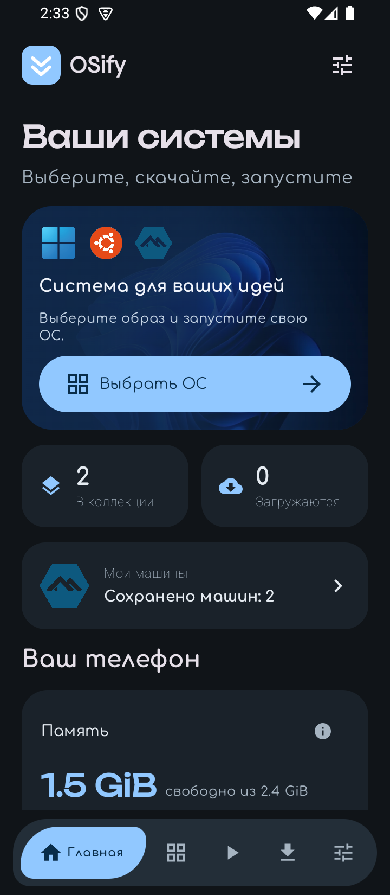
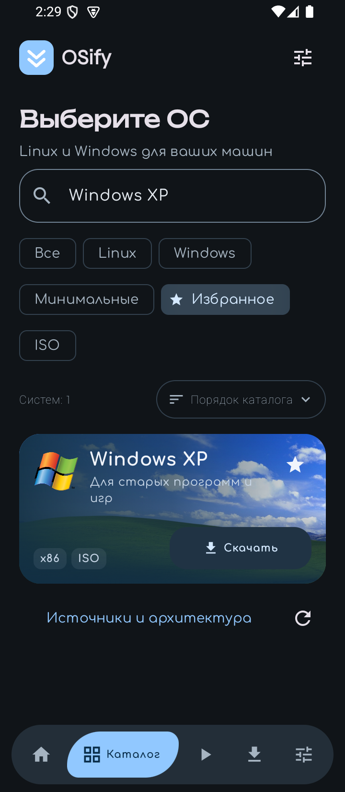
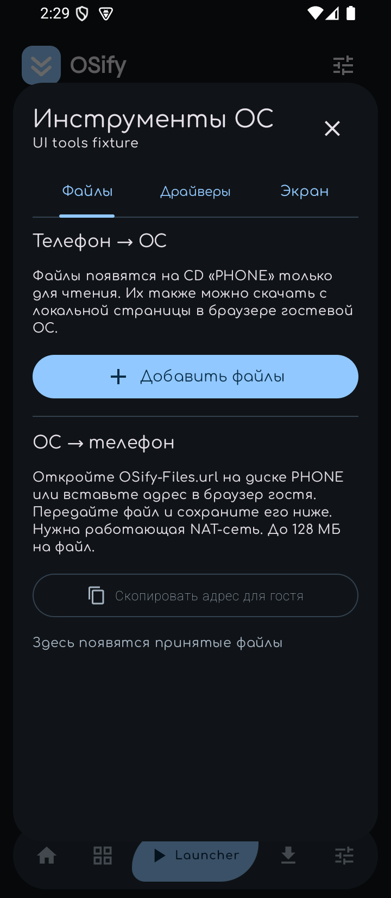

<p align="center"></p>

<h1 align="center">OSify</h1>
<p align="center"><strong>Every OS. One App.</strong><br>Каталог систем и встроенный PC-эмулятор для Android.</p>

<p align="center">
  <a href="https://github.com/FASTDROPX/OSify/releases/latest"></a>
  
  
  
</p>

<p align="center">
  <a href="https://github.com/FASTDROPX/OSify/releases/download/v0.4.12/OSify-0.4.12.apk"><strong>Скачать APK 0.4.12</strong></a> ·
  <a href="https://github.com/FASTDROPX/OSify/releases/tag/v0.4.12">Релиз и исходники</a> ·
  <a href="docs/RELEASE_0.4.12.md">Проверки и инструкция</a> ·
  <a href="CHANGELOG.md">Изменения</a>
</p>

OSify позволяет выбирать Linux и Windows, скачивать или импортировать образы, создавать виртуальные машины и управлять ими прямо с телефона. Встроенный QEMU запускается в отдельном процессе приложения — **без Termux и root**. Интерфейс использует Material 3 Expressive, русский и английский языки, светлую и тёмную темы.

**English:** OSify is a native Android OS catalog and PC emulator built with Kotlin, Jetpack Compose and embedded QEMU. Download or import media, create x86/x64 virtual machines, exchange files and control the guest from your phone. No Termux or root required; compatibility and performance depend on the guest and device.

## Как выглядит

<p align="center">
  
  
  
</p>

Снимки настоящего приложения 0.4.12 на Android API 35. Название машины на экране инструментов относится к тестовой машине.

## Возможности

| | Что доступно |
|---|---|
| **Каталог** | Превью и логотипы ОС, поиск, независимые фильтры, сохраняемая сортировка и избранное. Данные Quickget и встроенный снимок для работы без сети. |
| **Загрузки** | Прогресс, пауза и продолжение, проверка размера и доступных контрольных сумм. Импорт ISO, IMG и самостоятельных QCOW2. |
| **Launcher** | Сохранённые машины, поиск, RAM и CPU ползунками, BIOS/UEFI, Advanced-параметры, клонирование остановленной машины с её диском. |
| **Управление ОС** | Обычная Android-клавиатура, редактор текста и вставка, специальные клавиши, мышь/тачпад, масштабирование и подгонка. |
| **Экран** | Управление снизу в портретном режиме и справа в альбомном, fullscreen с доступной панелью, Android Picture-in-Picture. |
| **Обмен файлами** | Отдельный PHONE CD с Unicode-именами для файлов телефона; локальная страница для обратной передачи и сохранение через Android Documents. |
| **Драйверы** | Отдельный CD VirtIO-Win или собственный ISO, подключение и извлечение во время работы машины. |
| **Журналы** | События запуска, фактическая конфигурация, вывод QEMU и serial; сохранение/отправка TXT с маскированием известных секретов. |

В 0.4.12 также добавлены проверка реального загрузочного носителя, x86-профиль новых машин XP, явные приоритеты дисков/CD и дополнительные проверки ошибок запуска. [Подробный changelog →](CHANGELOG.md)

## Быстрый запуск

1. Установите [APK из Releases](https://github.com/FASTDROPX/OSify/releases/latest) на Android 8.0+ с ARM64 или x86_64.
2. Скачайте образ из каталога либо импортируйте свой ISO/IMG/QCOW2 во вкладке загрузок.
3. В Launcher нажмите **+**, выберите образ, RAM, ядра, размер диска и прошивку.
4. Нажмите **«Запустить»**, установите ОС на виртуальный диск. Для дальнейших запусков выберите **«Установленный диск»**.
5. В меню машины доступны параметры, клонирование, файлы/драйверы и TXT-журнал. В работающей ОС инструменты открываются из меню управления.

Одновременно работает одна машина. Диски хранятся в закрытом хранилище приложения. Удаление машины удаляет её виртуальный диск; удаление приложения — его локальные данные. Обычное завершение гостя выполняйте через меню питания самой ОС или соответствующее действие OSify.

### Файлы, драйверы и разрешение

- **Телефон → ОС:** добавьте файлы в инструментах машины. Они появятся на отдельном CD **PHONE**, только для чтения. После обновления гостю может потребоваться повторно открыть или перемонтировать диск.
- **ОС → телефон:** откройте `OSify-Files.url` с PHONE в браузере гостя, отправьте файл и сохраните его в OSify. Нужна работающая NAT-сеть гостя. Лимит — 128 МБ на файл.
- **Драйверы:** скачайте VirtIO-Win или импортируйте собственный ISO. Установка выполняется внутри Windows. Текущий VirtIO ISO не является набором драйверов для XP.
- **Поворот экрана:** изображение вписывается автоматически. Для изменения разрешения **внутри** ОС нужен помощник с PHONE: Windows 7+ с PowerShell 3+ либо Linux X11 с Python 3/xrandr. Режим должен поддерживаться гостевым видеодрайвером; помощники не поддерживают XP и Wayland.

## Совместимость и проверенные сценарии

| Параметр | Состояние |
|---|---|
| Устройства Android | ARM64 и x86_64, API 26+. ARM32 не поддерживается. |
| Архитектура гостя | x86 и x64. ARM64-гостевой QEMU в APK отсутствует. |
| Ускорение | Программная эмуляция TCG; KVM не используется. Тяжёлые Windows на ARM могут работать медленно. |
| XP SP3 x86 | Конкретный ISO дошёл до **Welcome to Setup** в эмуляторе Android. Полная установка и рабочий стол не проверены. |
| Alpine BIOS | Проверены загрузка, чтение PHONE, обратная передача, горячая смена CD и CD драйверов. |
| Tiny11 | Модификация Windows от NTDEV. Сообщённый пользователем ISO недоступен локально; его загрузка не подтверждена. |
| UEFI/Q35/Nehalem + Alpine | В тесте достигнут GRUB, но login не появился за 100 секунд. Полная загрузка этой комбинации не подтверждена. |
| Windows 11 | TPM 2.0 не эмулируется; обычный установщик может потребовать неподдерживаемое оборудование. |
| Звук / проброс GPU | Не реализованы в текущей интеграции движка. |
| 16 KiB Android | Включён page-size compatibility mode. Сторонние нативные библиотеки имеют ELF alignment 4 KiB; полная нативная поддержка 16 KiB и физическое устройство с такими страницами не проверены. |

Проверка VNC/QMP означает готовность **движка**, а не успешную загрузку гостевой ОС. Поддержка каталога не означает, что каждая версия каждой ОС полностью установлена и протестирована. Приложение не включает установочные ISO Windows/Linux; лицензии ОС и права на образы остаются отдельными.

Полный [отчёт 0.4.12](docs/RELEASE_0.4.12.md) разделяет фактически пройденные сценарии и непроверенные случаи.

## Сборка из исходников

Нужны **JDK 21**, **Android SDK 36** и **Build Tools 36.0.0**. Используются Gradle 8.13, AGP 8.13.2 и Kotlin 2.2.21. Нативные библиотеки включены; NDK для обычной сборки APK не нужен.

```bash
git clone https://github.com/FASTDROPX/OSify.git
cd OSify
```

Укажите путь к SDK через `ANDROID_HOME` или локальный `local.properties`.

```bash
# Linux / macOS
./gradlew :app:assembleDebug

# PowerShell / Windows
.\gradlew.bat :app:assembleDebug
```

APK: `app/build/outputs/apk/debug/app-debug.apk`.

```bash
# Проверки и release-сборка
./gradlew :core:test :app:testDebugUnitTest :app:lintRelease :app:assembleRelease
```

Release-APK из Gradle нужно подписать своим ключом. Приватный ключ опубликованного APK в репозиторий не включён. Для теста конкретного XP ISO можно задать `OSIFY_TEST_XP_ISO`; без него соответствующий тест пропускается. Гостевые инструментальные тесты требуют собственных тестовых ISO — см. их исходники.

### Структура проекта

```text
app/                         Android UI, Room/DataStore, загрузки и сервис QEMU
  src/main/cpp/              Исходник JNI-адаптера OSify
  src/main/assets/guest-tools/ Помощники изменения разрешения
core/                        Носители, аргументы QEMU, загрузки, RFB и обмен
third_party/native-sources/  Исходники QEMU/Limbo и нативных зависимостей
third_party/artwork-*/       Оригиналы изображений и сведения об источниках
licenses/                    Лицензии компонентов
docs/                        Инструкции, отчёты и скриншоты
tools/                       Вспомогательные скрипты сборки
```

Для пересборки JNI: `tools/build-native-bridge.ps1 -NdkRoot <NDK-r28.2>`. Нативные исходники, исходная конфигурация Limbo и хеши prebuilt-библиотек включены в [third_party](third_party/README.md). Git LFS для клонирования не требуется.

## Лицензии и авторство

Исходный код OSify имеет лицензию [Apache-2.0](LICENSE). JNI-адаптер, QEMU/Limbo, сторонние библиотеки, прошивки, данные Quickget, шрифты и изображения сохраняют **свои** лицензии и уведомления; Apache-2.0 не распространяется автоматически на них или на весь состав APK.

- [Состав и уведомления](THIRD_PARTY_NOTICES.md)
- [Соответствующие исходники нативного движка](third_party/README.md)
- [Источники логотипов и изображений](app/src/main/assets/branding/sources.json)
- [Сведения об обложках 0.4.10](docs/UI-0.4.10.md) и [0.4.11](docs/UI-0.4.11.md)

Товарные знаки и изображения ОС принадлежат соответствующим владельцам. Для части присланных и исторических изображений разрешение на дальнейшее распространение не подтверждено; это отмечено в документах происхождения. Они не объявляются свободными ресурсами OSify.

Автор проекта: [FASTDROPX](https://github.com/FASTDROPX). Ошибки и предложения: [Issues](https://github.com/FASTDROPX/OSify/issues). Перед отправкой изменений прочитайте [CONTRIBUTING.md](CONTRIBUTING.md).
