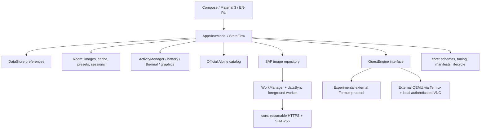

# OSify — Every OS. One App.

Рабочий Android-проект, **версия 0.4.2**. Каталог и «Загрузки» отвечают за файлы; центральная вкладка **Launcher** — за установку среды, выбор ОС, запуск и управление. Добавлен внешний QEMU через Termux и настоящий гостевой экран внутри OSify.

На QEMU хоста проверены командная строка Alpine x86_64 и появление установщика Windows 11, обмен клавишами и QMP-пауза/продолжение. Это не проверка Android/Realme и не подтверждение полной установки Windows. Интеграция Termux остаётся экспериментальной. Подробности и инструкция для ISO: [Launcher 0.4.0](docs/LAUNCHER_0.4.0.md).
Приложение не показывает фиктивную загрузку ОС, не поставляет образы Windows и не обещает ускорение устройства. Точное состояние функций и границы проверок описаны в [матрице функций](docs/FEATURE_MATRIX.md) и [отчёте об испытаниях](docs/TEST_RESULTS.md).

В 0.2.0 переработаны интерфейс, значок и приветствие, добавлены карточки Windows 10/11. Изменения и проверки этой версии: [UI_UPDATE.md](docs/UI_UPDATE.md). Более ранние отчёты в evidence относятся к 0.1.0; новые собраны отдельно в evidence/ui-0.2.0.

Обновление 0.3.0 по UI Kit: [реализация, источники, проверки и ограничения](docs/UI_REDESIGN_0.3.md).

Уточнения V11 в 0.3.1: [движение страниц, навигация и Page Morph](docs/UI_V11_0.3.1.md).

Обновление 0.3.2: [неподвижная шапка и плавная волна памяти](docs/UI_0.3.2.md).

Обновление 0.3.3: [частота экрана, плавные темы, AMOLED и затухание списка](docs/UI_0.3.3.md).

Обновление 0.4.1: [каталог и Launcher с изображениями ОС по референсу](docs/UI_0.4.1.md), рабочие фильтры и официальный Ubuntu ISO с SHA-256.

## Интерфейс 0.4.2

Карточки каталога раскрываются в полноэкранную страницу под неподвижной шапкой OSify. Присланные логотипы показаны без фона в одинаковом видимом размере 40 dp. Плашки и кнопка выровнены по нижнему краю карточки; большая кнопка Download Fill отображает настоящий прогресс. Обновлены обзор, Launcher, библиотека, настройки и знакомство. Подробности: [UI_0.4.2.md](docs/UI_0.4.2.md).

## Быстрый старт

Требования: JDK 21, Android SDK Platform 36, Build Tools 36.0.0, доступ к Google Maven/Maven Central. NDK не нужен: движки не собираются и не упаковываются в APK.

```bash
export ANDROID_HOME="/path/to/your/android-sdk"
export JAVA_HOME="/path/to/your/jdk-21"
./gradlew :core:test :app:testDebugUnitTest :app:lintDebug :app:assembleDebug
adb install -r app/build/outputs/apk/debug/app-debug.apk
```

SDK можно установить через Android Studio или официальные [командные инструменты](https://developer.android.com/tools). Gradle Wrapper 8.13 включён, его дистрибутив проверяется SHA-256. В проекте нет `local.properties`, локальных абсолютных путей или ключей подписи. Переменные прокси/доверенные CA для корпоративной сети задаются на стороне вашей среды; отключать TLS-проверку не нужно.

```bash
# Не требует интернета после получения зависимостей:
./gradlew :core:test :app:testDebugUnitTest

# Сеть нужна: загружает два официальных minirootfs, ARM64 и x86_64,
# проверяет манифесты и SHA-256 на JVM хоста; это не запуск гостя:
./gradlew :core:officialNetworkSmoke

# Подключённое Android-устройство или эмулятор:
./gradlew :app:connectedDebugAndroidTest
```

Исходные версии зависимостей закреплены. Проверены опубликованные официальные метаданные: на 2 ноября 2026 доступны AGP 9.5.0, Gradle 9.8.2, Kotlin 2.4.21 и Compose BOM 2026.09.00. Для этого воспроизводимого milestone выбрана совместимая более ранняя связка AGP 8.13.2 / Gradle 8.13 / Kotlin 2.2.21 / Compose BOM 2025.11.01. Версии не выдуманы; обоснование и ссылки — в [исследовании](docs/RESEARCH.md). Предупреждения lint о более новых версиях не скрываются.

## Что можно сделать

- Пройти или пропустить знакомство, повторить его в настройках.
- Смотреть физическую и доступную RAM через `ActivityManager.MemoryInfo`, оценку занятой памяти и историю наблюдений с интервалом 2,5 секунды. `total − available` не считается потреблением приложений; кэш Android не обозначается проблемой.
- Скачивать официальный Ubuntu Desktop x64 с проверкой SHA-256. Искать и фильтровать официальные Alpine minirootfs / standard ISO / virt ISO для ARM64 и x86_64. В комплекте — снимок официального списка выпусков, а не образы. Обновление проверяет официальный HTTPS-манифест; на экране видна дата кэша.
- Скачивать образ в закрытое хранилище. Работают прогресс, пауза, продолжение, повтор, явный полный перезапуск, проверка места, SHA-256 и атомарное завершение. Android управляет планированием фоновой работы.
- Импортировать ISO, IMG, QCOW2 и tar.gz через Storage Access Framework. Импорт копирует байты и считает локальный хеш; он не удостоверяет издателя, архитектуру или загрузочность файла. Архивы не распаковываются.
- Создавать конфигурации VM в Launcher: x64 ISO, RAM/CPU/диск, BIOS/UEFI + TPM. Старые профили JSON v1 сохраняются в базе и не применяются к этим машинам.
- Менять язык EN/RU, светлую/тёмную/системную тему, динамические цвета, движение, тактильный отклик, сеть загрузок, предупреждение о трафике, параллельность и профиль по умолчанию. Настройки хранятся в DataStore. Системное отключение анимации имеет приоритет; настройка движения передаётся Compose recomposer и Material-компонентам.
- Экспортировать диагностику и открыть системные настройки уведомлений/батареи по собственной инициативе.

## Linux и Windows

1. Установите Termux из F-Droid, откройте один раз. В **Launcher → Подготовка** скопируйте и выполните команду разрешения внешних приложений в Termux, затем включите интеграцию OSify и выдайте разрешение команд.
2. Нажмите «Включить / подготовить» повторно после выдачи разрешения. Termux установит QEMU, qemu-utils, swtpm, socat, curl и proot-distro из своих официальных репозиториев. Установка и её журнал видны в Launcher.
3. В «Загрузках» импортируйте свой `tiny11.iso` или Linux x64 ISO. Из каталога можно скачать Alpine x64 virt ISO. Архив minirootfs не является загрузочным ISO.
4. В Launcher создайте машину: выберите ISO, Windows/Linux, BIOS либо UEFI + TPM 2.0, ОЗУ, CPU и размер разреженного диска. Затем «С ISO → Запустить → Открыть экран».
5. Установите ОС на виртуальный диск. После завершения работы гостя и остановки QEMU выбирайте **«С диска»** для следующих запусков. Клавиатура, Esc/Tab/Ctrl+Alt+Del, мышь, масштаб и прокрутка находятся в гостевом экране.

**QEMU не включён в APK:** это отдельный процесс в Termux. Используется TCG, аппаратное ускорение KVM не заявляется. Windows x64 на ARM-телефоне может работать очень медленно. Память VM ограничена половиной физической RAM телефона. Обычная Windows 11 требует больше памяти; проверка требований не обходится. ISO копируется в закрытый каталог Termux, поэтому потребуется место под вторую копию и виртуальный диск. Сеть гостя — QEMU user-mode NAT, общие папки не подключаются.

Launcher также предлагает отдельную среду **Alpine Linux / PRoot**: её терминал и установка принадлежат Termux, используется ядро Android. Импортированный ISO к этой среде не относится. PRoot не резервирует отдельную RAM и не обеспечивает защитной изоляции.

Успешный callback запуска подтверждает создание процесса QEMU, но не загрузку ОС: результат нужно смотреть на гостевом экране. При перезапуске OSify состояния становятся «неизвестно», живая RAM не восстанавливается и внешние процессы не останавливаются. «Завершить» отправляет ACPI-запрос, «Принудительно остановить» — QMP quit после подтверждения. Закрытие гостевого экрана оставляет VM работающей в Termux.

Исходные образы и старые профили сохраняются при миграции Room 1 → 2. Удаление OSify удаляет его файлы, но диски в Termux остаются. Их удаление описано в [инструкции](docs/LAUNCHER_0.4.0.md).

## Надёжность и ограничения Android

`CoroutineWorker` использует foreground service типа `dataSync`, с видимым уведомлением, возвратом в приложение и паузой. INTERNET / ACCESS_NETWORK_STATE нужны для каталога и загрузок; POST_NOTIFICATIONS запрашивается при старте загрузки на Android 13+. Отказ не трактуется как разрешение: Android может показывать foreground-задачу в диспетчере вместо панели уведомлений. WorkManager добавляет системные разрешения/компоненты для планирования, wake lock и разрешённого восстановления после перезагрузки.

На Android 14+ объявлен тип foreground service. Android 15 ограничивает длительность `dataSync`, Android 16 — квоты задач, включая некоторые длинные WorkManager-задачи. Для этого milestone выбран WorkManager с возобновлением, а не обещание непрерывной многогигабайтной передачи. Отдельный User-Initiated Data Transfer JobService — следующий этап. Запуск background/foreground может быть отклонён платформой; тогда ошибка видна и требуется повтор из приложения. Изменения настроек сети применяются при добавлении/продолжении передачи.

Частичные данные сверяются с контрольной точкой SHA-256. При поддержке HTTP Range используются `If-Range`, сильный ETag либо корректный Last-Modified и строгая проверка Content-Range. Игнорирование Range, смена версии, повреждение частичного файла или отсутствие валидатора требуют явного подтверждения полной загрузки. Контрольные точки пишутся примерно каждые 8 MiB, когда провайдер SHA-256 поддерживает клонирование, а также при штатной паузе/ошибке; после жёсткого убийства процесса может быть отброшен неподтверждённый хвост. Если безопасной точки нет, приложение просит начать заново. Готовность файла отмечается только после размера, хеша и атомарного переименования.

Перезагрузка/убийство процесса не восстанавливают живую RAM гостя. OEM может прерывать работу. OSify не просит автоматического исключения из оптимизации батареи. Для загруженных файлов выбран закрытый каталог приложения: он удаляется при деинсталляции; выбор другого управляемого каталога пока не поддерживается. После прерывания SAF-импорта оригинал нужно выбрать повторно.

## Архитектура

Два Gradle-модуля и отдельные пакеты по ответственности; DI — явный application-scoped контейнер без дополнительного фреймворка.



`core` не зависит от Android. `app/data` хранит данные; `download` отвечает за foreground lifecycle, ограничения параллельности и файловые блокировки; `device` использует документированные API; `engine` отделяет внешние команды и callbacks; `ui` отображает состояния, не изобретая возможности движка. Полноценное разделение каждого пакета в самостоятельный Android-модуль оставлено после подтверждения встроенного движка.

## Безопасность, лицензии и распространение

- Только HTTPS и точный доверенный домен Alpine; редиректы проверяются до открытия соединения. Манифест ограничен размером, набором полей, безопасными именами файлов, архитектурами, размерами и SHA-256. SHA из того же HTTPS-источника обеспечивает целостность относительно манифеста, не независимую криптографическую аттестацию издателя.
- Имя импортированного файла используется только для отображения. Реальные имена — UUID в закрытом каталоге; архивы, ссылки, пути и гостевой код не исполняются и не извлекаются.
- Терминальный callback использует одноразовый mutable PendingIntent с явным неэкспортируемым receiver и случайным сохранённым токеном. Произвольные сообщения без соответствующего токена не меняют состояние.
- Нет broad storage, QUERY_ALL_PACKAGES, root, Shizuku, accessibility service, аналитики или аккаунта. Логи могут содержать личный вывод терминала; перед экспортом показано предупреждение.
- Android 10+ запрещает обычному приложению исполнение бинарников из собственного writable-каталога. OSify не обходит это снижением target SDK или исполняемыми скачиваниями. Termux — отдельное приложение со своим механизмом установки и ограничениями.
- Поставляется debug APK для ручной установки. Публикация в Google Play не выполнена и соответствие Play не заявляется. Встроенные нативные движки потребуют корректной упаковки в APK, проверки ABI/16 KiB pages/лицензий и отдельной проверки текущей политики исполнения кода.

Исходники OSify и оригинальная векторная графика — Apache-2.0, см. [LICENSE](LICENSE). Сведения о runtime-зависимостях и изученных движках — [THIRD_PARTY_NOTICES.md](THIRD_PARTY_NOTICES.md). Termux, proot-distro, QEMU, Limbo и UTM изучены по документации/исходникам; их реализация или бинарники в OSify не копируются. Официальные release-метаданные Alpine включены с указанием источника; сами дистрибутивы не включены в APK.

## Release-подпись

Сборка debug подписывается обычным автоматически созданным Android debug-ключом и не предназначена для публикации. Пользовательские release-ключи не созданы и не выдуманы.

```bash
./gradlew :app:assembleRelease
# Результат: app/build/outputs/apk/release/app-release-unsigned.apk
# Выполняйте с установленными Android Build Tools и СОБСТВЕННЫМ ключом:
zipalign -p -f 4 app/build/outputs/apk/release/app-release-unsigned.apk OSify-aligned.apk
apksigner sign --ks /path/to/your/private-release.jks --out OSify-release.apk OSify-aligned.apk
apksigner verify --verbose --print-certs OSify-release.apk
```

Пароли следует вводить по запросу инструмента или через секреты CI, не сохранять в репозитории. Для создания собственного ключа используйте [официальную инструкцию Android](https://developer.android.com/studio/publish/app-signing). Возможные ограничения и следующие шаги 1.0 перечислены в матрице функций; успешная сборка APK сама по себе не означает подтверждённый запуск гостевой ОС.
